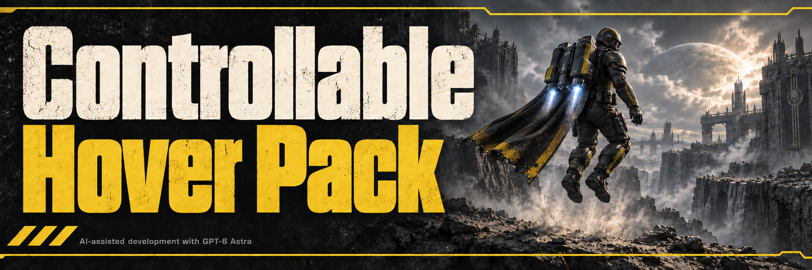

> Release for Steam build 25480438 / EXE 1.8.46015.0. Offline checks passed; checked in live play. Requires Bingus Shared Loader v18 or newer (v19 is current).

Performance update v1.8.1: between flights the mod waits for one, reading only the hover pack's state on most frames, or nothing on the ship and without a hover pack. Early descent was confirmed live on earlier releases.

# Controllable Hover Pack

Press Space again during hover-pack flight to descend early while preserving the pack's native landing assistance.

- **End flights early.** Vanilla hover flight runs until its automatic cutoff. Release Space after takeoff, then press it again to begin descending when you choose.
- **Native landing assistance.** The pack still slows your descent near the ground, including when you end a flight early.
- **Deliberate cancellation.** Holding the initial activation press does not cancel the flight; you must release and press again.
- **Normal duration on the next flight.** Ending one flight early does not shorten the next.

If you have rebound the Jump Pack action, use that binding instead of Space.

Release **v1.8.1** lowers the per-frame cost again. Measured in game: 0.003 ms per frame on the ship (0.009 before) and 0.003-0.004 in missions without a hover pack (0.016-0.018 before). Routine diagnostics are off by default; developers can set `CowboyBingusDiagnostics = true` before initialization to enable them.

Current version: **v1.8.1**, for game build **25480438**. See [changes](CHANGELOG.md) and [validation coverage](docs/MIGRATION_VALIDATION.md).

**AI disclosure:** Claude Opus 5.5 assisted with research, implementation, tests and documentation.

## License

Zero-Clause BSD (0BSD): use, copy, modify and distribute for any purpose, with no conditions. See `LICENSE`.
